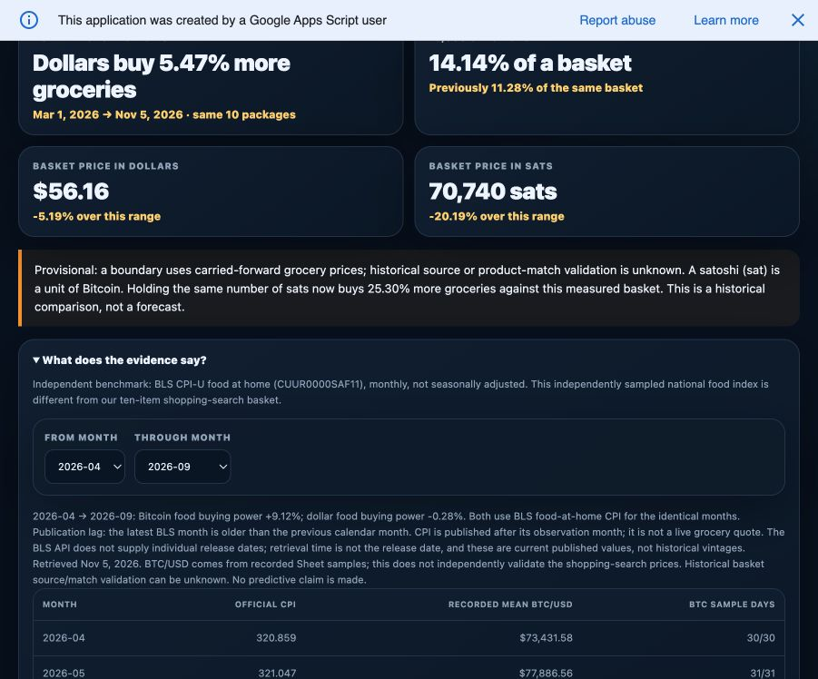

# Bitcoin benchmark release — November 5, 2026

PR #113 merged as 31d678891801a7b182ac95f2009a6b526231895d.

Existing production deployment updated to Apps Script version 112 at 7:36 PM America/Chicago. Previous version 111 remains the rollback target.

Live URL: https://script.google.com/macros/s/AKfycbxjVSAgNkKhgsmY6t8j1dKZ3sc1BrblZcbRuLYWGUWHMG40QCUvfc3XjUpnGbBIHU9k/exec

Authenticated /dev staging and the live /exec were verified against real read-only Sheet data and the live official BLS response. Six changed Apps Script files were copied back through the editor and compared exactly with tested source (Index.html, App.html, Dashboard.gs, Models.gs, Styles.html, FoodBenchmark.gs). GitHub Assistant pull failed with undefined; editor import was used instead. No collector functions, schedules, budgets, properties or Sheet rows were changed.

Verified outcomes:
- Existing fixed ten-package basket displays $56.16 / 70,740 sats; provisional history and carry-forward warning remain visible.
- Published September food CPI 321.758 matches the BLS/FRED figure.
- March–September withheld: March has 30/31 daily BTC samples. No gap interpolation.
- April–September: BTC food buying power +9.12%; dollars -0.28%, identical months.
- May–June: BTC food buying power -19.00%; dollars -0.18%, identical months.
- The first live benchmark request returned an RPC failure and displayed the retry warning. One reload succeeded; default and both signed comparisons were then verified in production. No claim of a permanently resolved transport issue.
- Existing measurement checks, 36 collector/reliability regressions, purchasing-power renderer tests, food benchmark tests and syntax/manifest checks passed.
- Browser viewport was unchanged; no separate phone-device test is claimed.

Rollback: Manage deployments → select this deployment → Edit → choose version 111 → Deploy. This retains the URL. Head source can be restored from the prior GitHub release if separately needed.

